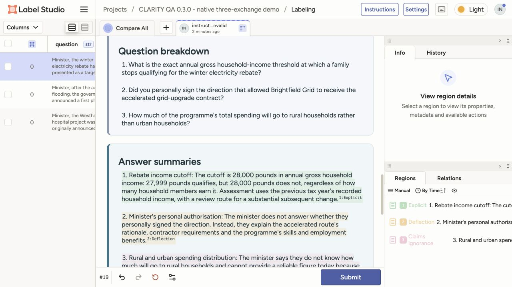

# English toy examples

[Annotation platform demo](http://spock.deep.islab.ntua.gr:9097) | [Annotator manual](CLARITY-Annotator-Guide.pdf)

Three fictional English political exchanges were processed live with the **OpenAI Responses API and `gpt-6.1-sol`**. Each contains three requests. The saved model output was exported using the standard **CLARITY QA 0.3.0** commands: **three complete-exchange tasks, nine numbered answer summaries, one annotator**. This toy study has no overlap and no controls.

## Import

1. Create a new Label Studio project and paste [labeling_config.xml](labeling_config.xml) into its Labeling Interface code.
2. Paste the complete [HTML instructions](ANNOTATION_INSTRUCTIONS_PASTE.txt), including the `<style>` block, into the Instructions field.
3. Import **[annotator_01.json](annotator_01.json)**. Read the original exchange and highlight each complete numbered answer summary with one response label.

The import contains no model pre-annotations or completed human judgments. Give annotators the import, XML, instructions and PDF. The analysis and provenance files below are coordinator material.

## Reproduce

Install this repository with `python -m pip install .`, then run from its root.

Re-export the saved live model output **without an API key or further model calls**:

```bash
python "toy data/English/run_demo.py" --reuse-analysis --output /tmp/clarity-english-demo
```

For a fresh OpenAI run:

```bash
export OPENAI_API_KEY="your-api-key"
CLARITY_MODEL=gpt-6.1-sol python "toy data/English/run_demo.py" --output /tmp/clarity-english-fresh
```

Choose a new output directory on each run. The script uses `analyze`, `prepare-study` and `export-study`; the saved-output option skips `analyze`. There is no demo-only conversion adapter. Output includes the per-annotator JSON, XML interface, HTML instructions, PDF manual and import guide. The coordinator study is stored next to it with a `-study` suffix.

## Evidence

- [Original JSON input](input.json) and [actual model output](analysis.output.json).
- [Original live model run receipt](model_run_receipt.json) and [original log](model_run.log). These preserve the 0.2.0 inference provenance and its historical export count; generated labels are unreviewed.
- [Current 0.3.0 export receipt](run_receipt.json) and [execution log](run.log). This run reused the saved analysis and produced the final three-task import through the standard package exporter.
- [Validation](validation.json): current package/Label Studio checks. Test annotations are synthetic and are not included in the import.

The workflow follows the complete-exchange, numbered-summary highlighting interface in Figures 19-20 of the [original paper](https://aclanthology.org/2024.findings-emnlp.300/). Use [annotation studies](../../docs/annotation-studies.md) with your own study configuration for multiple annotators, 20% overlap and optional reviewed counterfactuals.

## Verified browser workflow

A local Label Studio fixture was used to create and submit three independent answer-summary highlights in one task. The standard evaluator read the resulting browser-created offsets and exchange-level corrections successfully. The distributed JSON remains unannotated.


